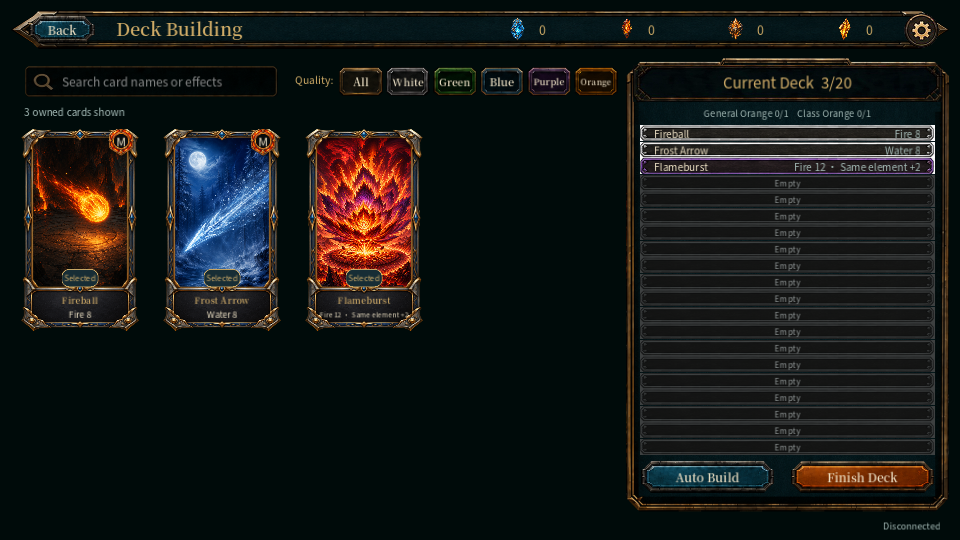
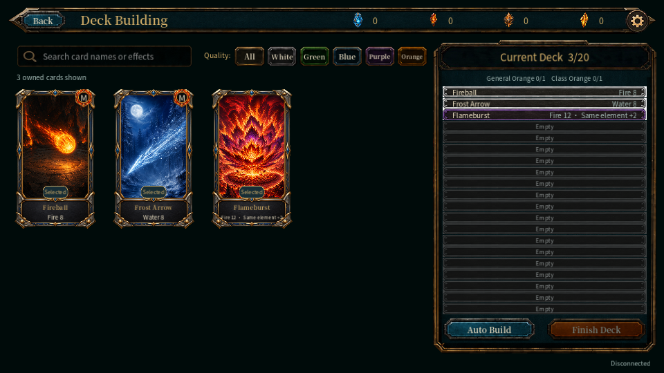

# A09.4-T01：脚本成功不能替代真实按钮验收（2026-10-21）

当前正式牌组界面的 SaveDeck 使用原回调，云端 Godot 4.7.2/Xvfb/Mesa 实际接收 viewport 鼠标移动、按下和松开事件，没有直接 emit pressed，也没有替换保存业务方法。三张卡的未满编草稿用于触发正式本地提示，未进行账号登录、真实保存或数据库操作。

中英文、960×540／1280×720／1920×1080，各测正常、禁用故障、恢复三态，每轮 18 幅。正常和恢复点击各收到一次真实 pressed，并显示正式“需满 20 张”提示；禁用按钮可见但点击无响应。最终 R3 的 native／APP／service／controller 均退出 0，12 个正对照可用，6 个禁用反例在 unchanged 当前裁决器中均为 Failed，不能用脚本退出 0 覆盖坏 UI。MAIN 仅关闭 A09.4-T01/RENDER 的预期拒绝性质，不授予 LIVE、POSTGRES、真正保存成功或整项验收。

前两轮失败完整保留，没有合并为“54 幅全通过”：

- R1：18 个实际按钮行为符合预期，但私有适配器把同一用例的两层证据拆成两条不完整记录，使正对照成为 Partial；它仅扫描 engine 文件，还漏掉 stdout 的退出音频告警。原 clean 字段不能作为干净退出依据。
- R2：修正证据组织、扫描两份完整日志并清理夹具持有的图像／观察回调后，18 个行为仍正确，但完整 stdout 指明音乐 MP3、环境 WAV 及其 playback 引用未释放，整轮仍失败。
- R3：按现有 `gameplay_load_client._prepare_audio_exit`，调用现有 Sound 停止接口并等待混音释放，实际 168ms。正式 UI 和音频服务源码没有改动，最终两份完整日志无脚本错误、资源泄漏或仍在使用的资源。这个结论限定于本夹具退出流程，不宣称任意时点退出或硬件音频质量通过。

54 张原始 PNG、三轮完整日志、退出码和所有失败均已回存 G 盘。已实际查看 8 张原图，覆盖全部六个语言／尺寸正对照及英文小屏禁用／恢复；六组按钮像素差异也独立核验。此三张卡草稿范围内，面板、标题和底部按钮可见，未发现需要重出资源的问题；不扩大成全牌库、所有 UI 状态或真人体验验收。本轮没有生成美术、修改正式 UI 或放宽标准。

2147 份当前客户端原字节及三份私有覆盖已完整归档，原生 Linux 引擎身份单独记录；共享导入缓存的 1244 份文件逐项复核摘要，但没有将其全量缓存字节或重建链路认定为已归档。因此不授予 A08.1 全谱系通过。源码和档案检查数量不是游戏场次，新增真实 UID、玩法场次和 PG 均为 0。传输中断先确认未安装、未启动，才按同一冻结包续传；原归档 API 失败与后续无损 xz 归档分别保留，没有重跑游戏来补下载。

本地只有 headless／windowed／Dummy／60FPS、无控制台窗口且低优先级的三次解析，渲染和输入事件均为 0；真实画面仅在当前云主机。用户数据通过私有 override.cfg 隔离，实际原生目录已核实。[Godot 项目覆盖与用户目录说明](https://docs.godotengine.org/en/stable/classes/class_projectsettings.html)。G 盘 294 份档案复核完成后，才清理三个精确拥有的云端输入目录；原始云端证据和共享缓存保留，生产指纹与健康 200 不变。

当前仍 100 Accepted／24 Partial／8 ReadyForAcceptance，32 项未验收；case/profile 缺口 117→116，所有全局门不升级。真实托管 CI 的账户启动阻断和当前主机不足的容量项仍保留。两个 GDD 及合法 80/70 约定没有变化。本轮没有新增 release 提交、推送或部署。

正常对照：

禁用反例（画面仍可正常生成，但实际点击不可用，裁决为 Failed）：

